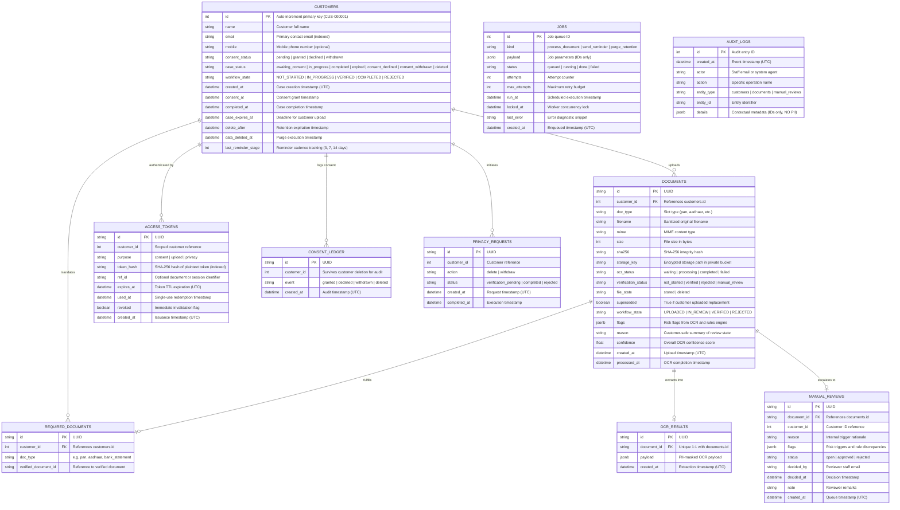

# DocPilot Database Architecture & Schema Specification

This document provides a comprehensive technical overview of the DocPilot relational database schema, state machines, entity relationships, and data protection policies.

The full executable PostgreSQL / Supabase DDL script is located in [schema.sql](file:///home/incraax-ai/Documents/Vighnesh/DocPilot/schema.sql).

---

## 1. Entity-Relationship Diagram (ERD)



---

## 2. Core Architectural Principles

### 2.1 Four Independent State Engines
DocPilot maintains four explicit, decoupled state fields instead of combining disparate lifecycle concepts:
1. `ocr_status` (`documents.ocr_status`): Tracks raw extraction (`waiting` -> `processing` -> `completed` / `failed`).
2. `verification_status` (`documents.verification_status`): Evaluated by business rules and manual review (`not_started` -> `verified` / `rejected` / `manual_review`).
3. `case_status` (`customers.case_status`): Tracks customer lifecycle (`awaiting_consent` -> `in_progress` -> `completed` -> `expired` -> `deleted`).
4. `file_state` (`documents.file_state`): Physical storage status (`stored` -> `deleted`).

> [!NOTE]
> **Pending Status is Derived**: "Pending" is never stored in the database. A customer's pending items are dynamically calculated as required documents lacking a valid `verified_document_id`.

### 2.2 Token-as-Identity Security
* Customer portal authentication does **not** rely on passwords or sessions.
* Instead, customers access portals using cryptographically random URL tokens.
* Only the **SHA-256 hash** of the token is stored in `access_tokens`.
* Tokens are scoped by purpose (`consent`, `upload`, `privacy`) and expire automatically.

### 2.3 Strict Data Minimization & Crypto-Shredding
* Document bytes are **AES-256-GCM encrypted** before being written to Supabase private storage.
* `ocr_results.payload` contains **only PII-masked data** (e.g., `XXXX-XXXX-1234`).
* When a case reaches retention expiry (`delete_after`) or upon right-to-erasure:
  1. The encrypted storage file is deleted.
  2. The `ocr_results` rows are purged.
  3. The `access_tokens` rows are removed.
  4. The `customers` record is scrubbed of name, email, and mobile.
  5. The `consent_ledger` preserves an anonymous compliance audit record.

---

## 3. Database Indexes

To maintain sub-10ms query times at scale, the following strategic B-tree indexes are enforced:

| Table | Index Column(s) | Optimization Goal |
| :--- | :--- | :--- |
| `customers` | `email` | Rapid deduplication check during intake |
| `customers` | `consent_status` | Filter awaiting vs granted customers |
| `customers` | `case_status` | Dashboard aggregations & status counts |
| `customers` | `workflow_state` | High-level operations pipeline filtering |
| `customers` | `delete_after` | Worker retention purge sweep query |
| `required_documents` | `customer_id` | Customer required slots lookup |
| `documents` | `customer_id` | Fetching documents for a customer case |
| `documents` | `workflow_state` | Admin review and intake queue filtering |
| `access_tokens` | `token_hash` (UNIQUE) | Constant-time magic link verification |
| `access_tokens` | `customer_id` | Invalidating old tokens on new issuance |
| `manual_reviews` | `customer_id`, `document_id` | Review drawer lookup and staff resolution |
| `jobs` | `status`, `run_at` | Worker `SKIP LOCKED` job polling query |
| `audit_logs` | `created_at` | Chronological audit trail pagination |

---

## 4. Setup in Supabase / PostgreSQL

To initialize this schema:
1. **Via Standalone DDL Script**:
   Execute `schema.sql` directly in your PostgreSQL client (`psql`) or Supabase SQL Editor.
2. **Row Level Security (RLS) & Policies**:
   RLS is enabled and forced on all 10 application tables. Least-privilege policies grant administrative access to `service_role` and `postgres`, while non-privileged client roles (`anon` and `authenticated`) have no permissive policies (DENY ALL by default). This locks out unauthorized public queries via PostgREST and anon client keys.
3. **Privileged Backend Connection**:
   The DocPilot FastAPI backend connects via the privileged connection string (Session Pooler) to execute authorized operations under the `service_role` / `postgres` role.

---

## 5. Migrations as Source of Truth

The version-controlled source of truth for all schema modifications is the Alembic migration history located in `backend/alembic/versions/`:
- `7b850ab9a48f_initial_schema.py`: Initial schema definition creating all 10 core tables, foreign keys, and primary indexes.
- `07648b259a0d_add_workflow_state.py`: Addition of operational `workflow_state` columns on `customers` and `documents`.
- `c4e2a8910b7f_enable_rls_and_policies.py`: Forward-only migration enabling and forcing Row Level Security (RLS) across all 10 application tables with explicit least-privilege policies for `service_role` and `postgres`.

### Managing Migrations

```bash
cd backend
source .venv/bin/activate

# Apply migrations up to head (recommended)
python -m app.db_init
# or directly via Alembic CLI:
alembic upgrade head

# Check current revision status
alembic current

# Create a new migration after updating app/models.py
alembic revision --autogenerate -m "description_of_change"
```
